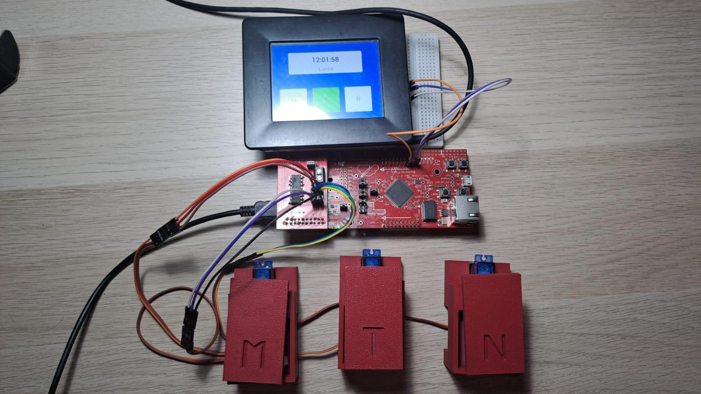
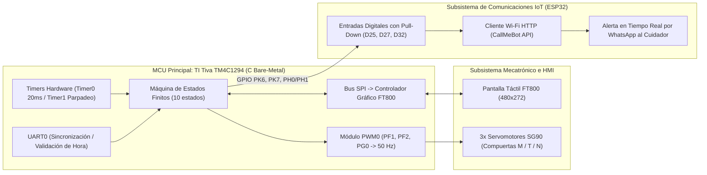
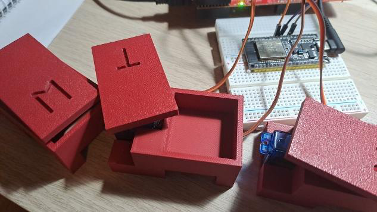
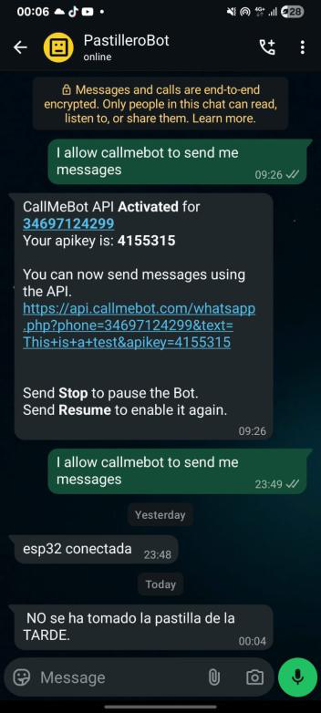
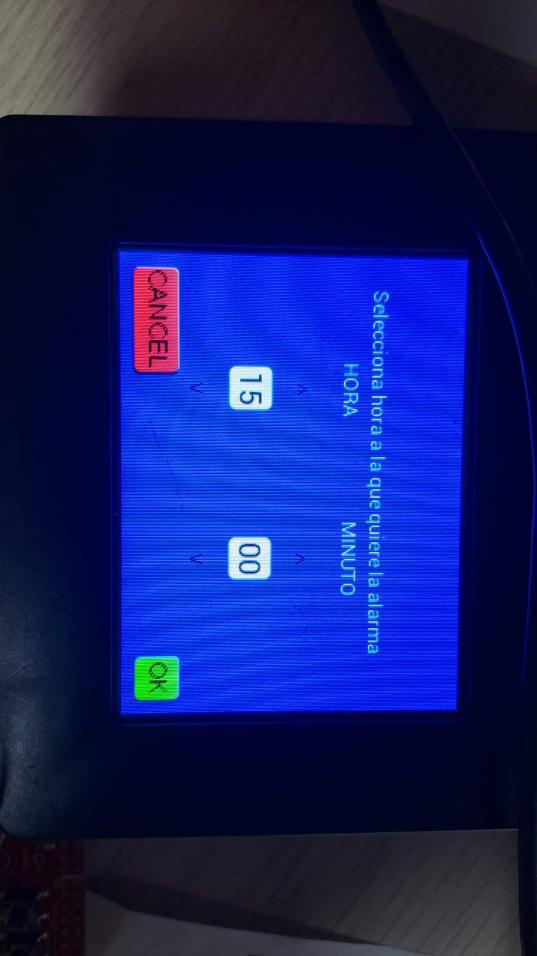
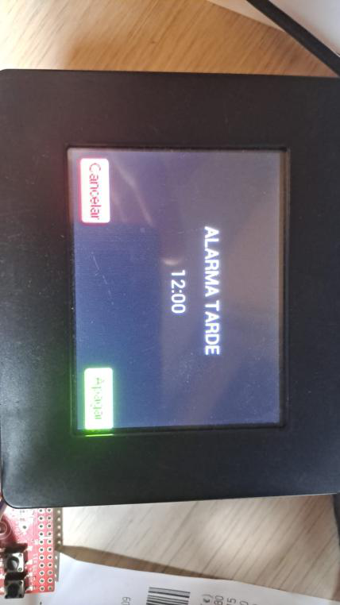
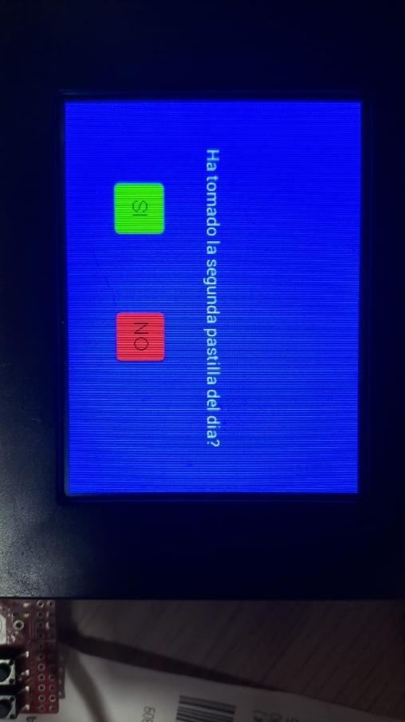

# P.E.P.A. — Pastillero Electrónico Programable Automatizado (TI Tiva ARM Cortex-M4F + ESP32 IoT)

[-CC0000?style=for-the-badge&logo=texas-instruments&logoColor=white)](entregables/ProyectoSEPA/main.c)
[-00979D?style=for-the-badge&logo=espressif&logoColor=white)](entregables/WIfi/WIfi.ino)
[](entregables/ProyectoSEPA/main.c)
[](3D/)

> 📄 **Documentación Técnica y Presentación:**
> - **Memoria Técnica Completa (PDF):** [`Memoria Proyecto/Memoria Proyecto Micro.pdf`](Memoria%20Proyecto/Memoria%20Proyecto%20Micro.pdf)
> - **Presentación de Ingeniería (PDF):** [`Presentacion Proyecto/Presentacion_PEPA.pdf`](Presentacion%20Proyecto/Presentacion_PEPA.pdf)

---

## 🎯 Descripción General del Sistema

**P.E.P.A. (*Pastillero Electrónico Programable Automatizado*)** es un sistema embebido mecatrónico y conectado (IoT) diseñado para garantizar la adherencia farmacológica en pacientes polimedicados o personas mayores dependientes.

El sistema combina una arquitectura de **control en tiempo real sobre un microcontrolador ARM Cortex-M4F (`TI Tiva TM4C1294NCPDT`)**, una **interfaz gráfica táctil (`FT800` por bus `SPI`)**, **actuación electromecánica mediante 3 servomotores (`PWM`)** alojados en compartimentos impresos en 3D (Mañana, Tarde y Noche) y un **coprocesador inalámbrico `ESP32`** que envía notificaciones en tiempo real al teléfono móvil del cuidador vía **WhatsApp (`CallMeBot HTTP API`)** cuando una toma es omitida o pospuesta.



---

## 🏗️ Arquitectura Hardware y Firmware

El diseño se divide en tres subsistemas acoplados:



### 1. Unidad Central de Proceso (`TI Tiva TM4C1294NCPDT` — [`main.c`](entregables/ProyectoSEPA/main.c))
Programada en **C bare-metal con librería `TivaWare`** bajo reloj del sistema a **120 MHz (`SysCtlClockFreqSet`)**:
- **Máquina de Estados Finitos Determinista (`switch(estado_actual)`):** Gestiona de forma no bloqueante **10 estados operativos**:
  - `Estado 0`: Inicialización y selección del modo de puesta en hora (Pantalla táctil vs Terminal serie `UART`).
  - `Estado 1`: Configuración interactiva de hora inicial y día de la semana en pantalla táctil `FT800`.
  - `Estado 2`: Menú principal con reloj en tiempo real (`HH:MM:SS`), día de la semana y acceso a los 3 compartimentos (**M**añana, **T**arde, **N**oche) con codificación cromática de estado (blanco = desactivado, verde = alarma programada).
  - `Estado 3` y `Estado 4`: Submenús de apertura manual o programación/cancelación de alarma para cada compartimento.
  - `Estado 5` y `Estado 6`: Disparo de alarma activa con parpadeo visual (`Timer1`), opción de **Apagar** (dispensación inmediata) o **Posponer** (+5 minutos).
  - `Estado 7`: Confirmación de toma en dos pasos (*"¿Ha tomado la pastilla?"* → **SÍ / NO**), bloqueando el cierre prematuro de la compuerta para evitar atrapamientos y disparando la alerta IoT en caso de omisión.
  - `Estado 8` y `Estado 9`: Sincronización y recarga remota vía **UART** con validación estricta de formato (`DD HH:MM:SS`), rangos numéricos y detección de errores de trama.
- **Temporización Hardware por Interrupciones:**
  - `Timer0` configurado a **20 ms (`50 Hz`)**: Base de tiempos para el refresco de la pantalla `FT800`, muestreo táctil (`Lee_pantalla()`) y cómputo del reloj calendario interno.
  - `Timer1`: Interrupción dedicada para la alternancia visual durante estados de alarma activa.
- **Control de Servomotores por `PWM` Hardware:**
  - Generadores `PWM_GEN_0` y `PWM_GEN_1` sobre los pines `PF1` (Mañana), `PF2` (Tarde) y `PG0` (Noche) a frecuencia de servo estándar, con funciones dedicadas (`abrir_comp1..3`, `cerrar_comp1..3`) que posicionan el eje entre los ángulos calibrados de cierre (`POS_MIN`) y apertura (`POS_MAX`).

---

### 2. Subsistema de Comunicaciones IoT (`ESP32` — [`WIfi.ino`](entregables/WIfi/WIfi.ino))
Para dotar al pastillero de telemetría remota sin bloquear el lazo de tiempo real de la Tiva:
- **Interfaz Física `GPIO` (`Tiva → ESP32`):** La Tiva señaliza eventos críticos activando los pines digitales `PK6`, `PK7` y `PH0/PH1`. El `ESP32` muestrea las líneas en los pines `GPIO 25`, `GPIO 27` y `GPIO 32` (configurados con resistencias `INPUT_PULLDOWN` internas) aplicando lógica de detección de flanco de subida (`estadoActual == HIGH && estadoAnterior == LOW`).
- **Notificación HTTP a WhatsApp (`CallMeBot`):** Al detectar un flanco positivo por incomparecencia o rechazo de toma en cualquiera de las tres franjas horarias, el `ESP32` construye una petición `HTTP GET` autenticada que entrega instantáneamente un mensaje de alerta en el WhatsApp del familiar o cuidador.

| Detalle de Servomotores y Módulo ESP32 | Alerta Real Recibida en WhatsApp |
| :---: | :---: |
|  |  |

---

### 3. Interfaz Gráfica Táctil (`FT800` vía `SPI`) y Diseño Mecánico 3D

| Selección de Alarma en Pantalla FT800 | Alarma Activa (Apagar / Posponer) | Verificación de Toma Segura |
| :---: | :---: | :---: |
|  |  |  |

- **Diseño CAD e Impresión 3D ([`3D/`](3D/) y [`Archivos_Impresion_3D/`](Archivos_Impresion_3D/)):** Cajas modulares y tapas rotatorias diseñadas a medida en **Autodesk Fusion 360** (`Caja_Pastillero.f3d`, `Tapa_Pastillero.f3d`) con alojamiento integrado para micro-servos SG90 y grabado identificativo (`M`, `T`, `N`).

---

## 👥 Autoría y Contribución

Proyecto desarrollado para la asignatura de **Sistemas Electrónicos Programables Avanzados** del **Grado en Ingeniería Electrónica, Robótica y Mecatrónica** (Escuela Técnica Superior de Ingeniería — **Universidad de Sevilla**):

- **Francisco Delgado Capote** ([@Curro110](https://github.com/Curro110)): **Arquitectura Principal de Firmware y Subsistema de Comunicaciones.** Responsable del diseño de la estructura base de la máquina de estados finitos en C sobre la placa `TI Tiva TM4C1294`, la programación y validación robusta del protocolo serie `UART` para sincronización horaria/recarga y el desarrollo íntegro de la capa de comunicaciones (`GPIO` + cliente Wi-Fi/HTTP en `ESP32` con API de WhatsApp).
- **Alejandro Roche Aniento**: **Refinamiento de Interfaz, Integración Electromecánica y Modelado 3D.** Responsable de la optimización de pantallas y transiciones de usuario en el controlador `FT800`, calibración de lazos `PWM` de las compuertas, diseño CAD en Fusion 360 e integración física del prototipo.

---

## 📂 Estructura del Repositorio

```text
Micro_SEPA/
├── entregables/
│   ├── ProyectoSEPA/
│   │   ├── main.c                        # Firmware principal en C (TI Tiva TM4C1294NCPDT)
│   │   └── HAL_pantalla/                 # Librería gráfica SPI para pantalla FT800
│   └── WIfi/
│       └── WIfi.ino                      # Firmware IoT en C++/Arduino para ESP32 (WhatsApp HTTP)
├── 3D/                                   # Diseños paramétricos originales (.f3d Fusion 360 y .stl)
├── Archivos_Impresion_3D/                # Perfiles de laminado (.3mf) e impresión 3D
├── Memoria Proyecto/
│   └── Memoria Proyecto Micro.pdf        # Memoria técnica completa (13 páginas)
├── Presentacion Proyecto/
│   └── Presentacion_PEPA.pdf             # Diapositivas de defensa del proyecto
├── docs/img/                             # Fotografías del prototipo real, HMI y capturas IoT
└── README.md                             # Documentación del proyecto
```

---

## 🛠️ Guía de Despliegue y Configuración

### 1. Compilación del Firmware de la Tiva (`main.c`)
1. Abre **Code Composer Studio (CCS)** de Texas Instruments.
2. Importa el proyecto ubicado en [`entregables/ProyectoSEPA`](entregables/ProyectoSEPA).
3. Verifica que la librería **TivaWare (`driverlib`)** esté correctamente enlazada en las propiedades del proyecto.
4. Conecta la placa **EK-TM4C1294XL LaunchPad** por USB y pulsa **Debug / Flash**.

### 2. Configuración del Módulo Wi-Fi `ESP32` y API de WhatsApp (`CallMeBot`)
1. **Activación del Bot en WhatsApp:**
   - Añade a tus contactos el número `+34 644 59 71 67` (o el número activo en [callmebot.com](https://www.callmebot.com/blog/free-api-whatsapp-messages/)).
   - Envíale por WhatsApp el mensaje exacto: `I allow callmebot to send me messages`.
   - Recibirás tu `apikey` personal asociada a tu número de teléfono.
2. **Carga del Sketch en el `ESP32` ([`entregables/WIfi/WIfi.ino`](entregables/WIfi/WIfi.ino)):**
   - En **Arduino IDE**, añade en *Preferencias → Gestor de URLs adicionales* la placa ESP32 (`https://raw.githubusercontent.com/espressif/arduino-esp32/gh-pages/package_esp32_index.json`) e instala el paquete **`esp32` by Espressif Systems**.
   - Selecciona la placa **ESP32 Dev Module** y configura tus credenciales en `WIfi.ino`:
     ```cpp
     const char* ssid = "TU_WIFI_SSID";
     const char* password = "TU_WIFI_PASSWORD";
     String phoneNumber = "34XXXXXXXXX"; // Tu número con prefijo internacional
     String apiKey = "TU_API_KEY";       // API Key recibida de CallMeBot
     ```
   - Compila y sube el programa manteniendo pulsado el botón `BOOT` del `ESP32` si tu placa lo requiere.
